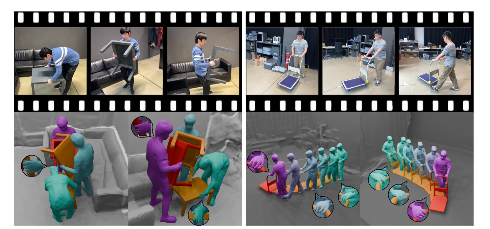

<p align="center">
  <h1 align="center">RHINO: Reconstructing Human Interactions<br>with Novel Objects from Monocular Videos</h1>
  <p align="center">
    <a href="https://lxxue.github.io/">Lixin&nbsp;Xue</a>
    ·
    <a href="https://chengwei-zheng.github.io/">Chengwei&nbsp;Zheng</a>
    ·
    <a href="https://gpaschalidis.github.io/">Georgios&nbsp;Paschalidis</a>
    ·
    <a href="https://moygcc.github.io/">Chen&nbsp;Guo</a>
    <br>
    <a href="https://manuelkaufmann.ch/">Manuel&nbsp;Kaufmann</a>
    ·
    <a href="https://ait.ethz.ch/people/jzarate">Juan&nbsp;Zarate</a>
    ·
    <a href="https://dtzionas.com/">Dimitrios&nbsp;Tzionas</a>
  </p>
  <h2 align="center">
    <p>CVPR 2026</p>
    <a href="https://files.ait.ethz.ch/projects/rhino/rhino_main.pdf">Paper</a>
    | <a href="https://lxxue.github.io/RHINO/">Project Page</a>
    | <a href="https://www.youtube.com/watch?v=r6Q_6quGclg">Video</a>
    | <a href="https://rhino.ait.ethz.ch/">Dataset</a>
  </h2>
  <p align="center">
    <a href="https://github.com/lxxue/RHINO"></a>
    <br>
    <em>RHINO jointly reconstructs humans, novel manipulated objects, and static scenes in a common world frame from monocular RGB videos.</em>
  </p>
</p>

## Installation

Training environment setup (Python >= 3.10, CUDA >= 12.1).

<details>
<summary>Setup steps [click to expand]</summary>

#### Prerequisites

- Python >= 3.10
- CUDA >= 12.1
- PyTorch >= 2.1.1

#### Setup

1. Create the RHINO environment:
```bash
conda create -n rhino python=3.10
conda activate rhino
```

2. Clone the repository (with submodules):
```bash
git clone --recursive https://github.com/lxxue/RHINO.git
cd RHINO
```

3. Install PyTorch (with CUDA 12.1):
```bash
pip install torch==2.1.1 torchvision==0.16.1 --index-url https://download.pytorch.org/whl/cu121
```

4. Install PyTorch3D and Kaolin:
```bash
pip install "setuptools<70"   # torch 2.1.1 source builds need pkg_resources.packaging
pip install --no-build-isolation "git+https://github.com/facebookresearch/pytorch3d.git"
pip install kaolin==0.17.0 -f https://nvidia-kaolin.s3.us-east-2.amazonaws.com/torch-2.1.1_cu121.html
```
PyTorch3D builds from source against the installed torch; `--no-build-isolation`
(and the setuptools pin) are required with current pip, which otherwise builds
it in an isolated environment without torch.

5. Install the package:
```bash
pip install -e .
```

6. Download the licensed SMPL-X model assets from the
   [SMPL-X website](https://smpl-x.is.tue.mpg.de/) and place these files in
   `rhino/checkpoints/smplx/`:
   - `SMPLX_NEUTRAL.npz`
   - `MANO_SMPLX_vertex_ids.pkl`
   - `SMPL-X__FLAME_vertex_ids.npy`

   Training checks all three paths at startup and reports the complete missing
   set. The two vertex-correspondence files are included in the SMPL-X model
   download layouts used by AiOS; they are not redistributed here because the
   body-model assets require separate acceptance of their licenses.

   If you plan to run the preprocessing pipeline, additionally place
   `SMPLX_MALE.npz`, `SMPLX_FEMALE.npz`, and `SMPLX_to_J14.pkl` in the same
   directory (step 6 constructs a male SMPL-X internally and needs the J14
   regressor; steps 9/11 load the npz matching `--gender`).

7. Recommended on shared machines: run installs and all commands with
   `export PYTHONNOUSERSITE=1`. Packages left in `~/.local/lib/pythonX.Y/`
   otherwise leak into conda environments — pip silently skips installing
   dependencies it sees there, producing environments that break once the
   user-site content changes.

</details>

## Demo

A self-contained demo bundle (7.6 GB) lets you inspect results or run the
model directly, without going through the preprocessing pipeline:
**[rhino_demo.zip](https://files.ait.ethz.ch/projects/rhino/rhino_demo.zip)**
([Google Drive mirror](https://drive.google.com/file/d/10MM2aTyJgvERXEgGSNHGXZr-btdMIwEC/view?usp=sharing)).
Unzipping yields `rhino_demo/{data,results}` with one in-the-wild sequence
(`demo_table`):

- `data/inthewild/demo_table/processed/` — the fully preprocessed sequence
  (layout described in [Data Format](#data-format));
- `results/demo_table/hoi/pretrained/checkpoints/` — the trained checkpoint;
- `results/demo_table/hoi/pretrained/epoch_0000/` — pre-rendered results,
  viewable without a GPU: per-frame comparison renders (ground truth |
  prediction | error) in `rgb/`, `normal/`, and `depth/`, per-branch renders
  (`*_fg`, `*_obj`, `*_bg`), and mesh exports (`mesh_deformed/`, `mesh_obj/`,
  `mesh_canonical/`, `obj.ply`, `scene.ply`).

To re-render everything from the checkpoint:
```bash
cd rhino
python train.py dataset=demo_table \
    data_root=/path/to/rhino_demo/data \
    result_root=/path/to/rhino_demo/results \
    version=pretrained test_only=True model.test_render_image=True wandb=False
```
Replace `test_only=True model.test_render_image=True` with
`model.is_continue=True` to continue training from the checkpoint instead.
Checkpoints for the seven stage sequences are available separately — see
[Pretrained checkpoints](#pretrained-checkpoints).

## Preprocessing

The preprocessing pipeline includes steps 0-13 plus a finalize step, covering the full path from raw video to training-ready `processed/` directory. All scripts use `tyro` for CLI argument parsing.

Hand-mask detection is currently less robust than the human and object masks. We keep it enabled for now, but it should be inspected before relying on it downstream.

<details>
<summary>Tool environments [click to expand]</summary>

#### Dependencies

| Tool | Version | Notes |
|------|---------|-------|
| COLMAP | 3.13.0.dev0 (commit 8ecac89e) | Built with CUDA |
| GLOMAP | Built from source | With CUDA support |
| pycolmap | 3.10.0 | Python bindings for COLMAP |
| hloc | 1.5 | Custom fork with image mask support |
| SAM2 | From Grounded-SAM-2 submodule | Segment Anything 2 |
| MASt3R | `third_party/mast3r` on `main` | HOI extensions |
| AiOS | `third_party/AiOS` (lxxue fork) | SMPL-X body estimation |
| Sapiens | `third_party/sapiens` (facebookresearch) | Whole-body pose estimation |
| Metric3D | `third_party/Metric3D` (YvanYin) | Monocular depth + normals |
| InteractVLM | `third_party/InteractVLM` (lxxue fork) | Contact vertex prediction |

**Cross-environment note**: Steps 4, 6, 7, and 12 may be invoked with separate Python interpreters (e.g., AiOS, Sapiens, InteractVLM envs). The scripts automatically add the RHINO repo root to `sys.path`, so the `rhino` package is importable without a separate install in each environment. Every tool environment does need `tyro` installed — each preprocessing script parses its CLI with tyro under whichever interpreter runs it (the setup blocks above include it).

#### Tool environment setup

1. Initialize submodules (if not cloned with `--recursive`):
```bash
git submodule update --init --recursive
```

2. Install the base camera-pose dependencies in the RHINO environment:
```bash
pip install pycolmap==3.10.0
pip install --no-deps -e third_party/Hierarchical-Localization/
```
`--no-deps` matters: hloc's unpinned requirements pull the latest
`opencv-python`, which forces a numpy>=2 upgrade and breaks the pinned kaolin
build. Its runtime dependencies are already satisfied by the RHINO
environment. (If numpy ever ends up at 2.x, `pip install "numpy<2"` restores
the working state.)

3. Set up SAM2 environment (recommended: separate conda env):
```bash
conda create -n sam2 python=3.11
conda activate sam2
pip install -e third_party/Grounded-SAM-2/
# Runtime deps of create_masks.py not installed by Grounded-SAM-2 itself
# (GroundingDINO runs via HuggingFace transformers; 5.x is untested — pin <5):
pip install "transformers<5" supervision opencv-python imageio tyro
# Download the SAM 2.0 checkpoint. The pipeline defaults to sam2_hiera_large.pt;
# the submodule's download_ckpts.sh fetches only the newer SAM 2.1 weights.
wget -P third_party/Grounded-SAM-2/checkpoints \
  https://dl.fbaipublicfiles.com/segment_anything_2/072824/sam2_hiera_large.pt
```

4. Set up MASt3R environment (recommended: separate conda env):
```bash
conda create -n mast3r python=3.11
conda activate mast3r
pip install -r third_party/mast3r/requirements.txt
pip install -r third_party/mast3r/dust3r/requirements.txt
# SfM-side deps of mast3r_matching.py (glomap mapping path):
pip install pycolmap==3.10.0 kapture kapture-localization poselib imageio tyro
pip install --no-deps -e third_party/Hierarchical-Localization/
```
MASt3R is not a pip package; the pipeline imports it by adding
`third_party/mast3r` to `sys.path` at run time. The model weights
(`naver/MASt3R_ViTLarge_BaseDecoder_512_catmlpdpt_metric`) download
automatically from Hugging Face on first use — no manual checkpoint step.

5. Set up AiOS environment (for SMPL-X estimation, step 6; also needed for step 7 keypoint conversion):
```bash
conda create -n aios python=3.10
conda activate aios
# chumpy's setup.py breaks under pip build isolation — install it first:
pip install "numpy<1.24" "setuptools<70" wheel "cython<3.1" ninja psutil
pip install --no-build-isolation chumpy
cd third_party/AiOS && pip install -r requirements.txt && cd -
pip install torch==2.1.1 torchvision==0.16.1 --index-url https://download.pytorch.org/whl/cu121
pip install addict yapf debugpy tyro
# mmcv-full 1.6.1 with CUDA ops, built from source. Two patches are required:
# C++17 (torch >= 2.1 headers demand it) and a torch-2.x DDP compat fix.
git clone --depth 1 -b v1.6.1 https://github.com/open-mmlab/mmcv.git /tmp/mmcv-1.6.1
cd /tmp/mmcv-1.6.1
sed -i 's/-std=c++14/-std=c++17/g' setup.py
git apply /path/to/RHINO/patches/mmcv-1.6.1-torch2-compat.patch
MMCV_WITH_OPS=1 FORCE_CUDA=1 pip install --no-build-isolation .
cd -
# PyTorch3D (v0.7.5, source build against the torch above):
pip install --no-build-isolation "git+https://github.com/facebookresearch/pytorch3d.git@v0.7.5"
# Build AiOS's vendored Deformable-DETR CUDA op:
cd third_party/AiOS/models/aios/ops && python setup.py build install && cd -
# Download the AiOS checkpoint to third_party/AiOS/data/checkpoint/aios_checkpoint.pth
# (https://github.com/ttxskk/AiOS releases / project page).
# AiOS also needs the licensed body models (SMPL / SMPL-X websites).
# NOTE: the submodule currently ships a stale data/body_models symlink —
# remove it first, then create real directories or symlinks:
#   rm third_party/AiOS/data/body_models
#   mkdir third_party/AiOS/data/body_models
#   third_party/AiOS/data/body_models/smpl/SMPL_NEUTRAL.pkl
#   third_party/AiOS/data/body_models/smplx/  (symlink to rhino/checkpoints/smplx works,
#     with the preprocessing extras from Installation step 6)
# Use real directories or symlinks to persistent locations (not /tmp).
```

6. Set up Sapiens environment (for keypoint estimation, step 7):
```bash
conda create -n sapiens python=3.10
conda activate sapiens
pip install torch==2.4.1 torchvision==0.19.1 --index-url https://download.pytorch.org/whl/cu121
pip install "setuptools<70"       # sapiens setup.py files import pkg_resources
# chumpy's setup.py breaks under pip build isolation — install it first:
pip install numpy wheel cython
pip install --no-build-isolation chumpy
pip install scipy munkres tqdm fsspec yapf==0.40.1 matplotlib packaging omegaconf ipdb ftfy regex
pip install json_tricks terminaltables modelindex prettytable albumentations pandas scikit-learn tyro
# Do NOT install libcom or transformers here: libcom pulls the real PyPI
# mmdet/mmpose (which shadow the sapiens forks and crash on import) and
# upgrades torch; a present transformers breaks mmpretrain's gated BLIP
# modules. If either got pulled in, `pip uninstall mmdet mmpose transformers`.
cd third_party/sapiens
pip install --no-build-isolation -e engine/
pip install --no-build-isolation -e cv/ && pip install -r cv/requirements/optional.txt
pip install --no-build-isolation -e pretrain/
pip install --no-build-isolation -e pose/
pip install --no-build-isolation -e det/
# mmpose/mmdet resolve configs through a .mim tree that a plain editable
# install does not create (openmim would):
mkdir -p pose/mmpose/.mim det/mmdet/.mim
ln -s ../../configs ../../demo ../../tools pose/mmpose/.mim/ 2>/dev/null || true
ln -s ../../configs ../../tools det/mmdet/.mim/ 2>/dev/null || true
cd -
# xtcocotools PyPI wheels are built against numpy 2 — rebuild from source so
# it matches the environment's numpy:
pip install --force-reinstall --no-binary xtcocotools --no-build-isolation xtcocotools
pip install "setuptools<70"       # re-pin; later installs may upgrade it
# Download RTMDet and Sapiens wholebody checkpoints
# (https://github.com/facebookresearch/sapiens — rtmdet_m person detector and
# sapiens_2b_coco_wholebody; pass their root via --tools.sapiens-checkpoint-root)
```
Note: step 7 runs Sapiens (`pose/demo/demo_vis.py`) under the Sapiens
interpreter, then converts `coco_wholebody -> smplx` keypoints in a separate
subprocess under the AiOS interpreter (which provides `detrsmpl` from the AiOS
submodule) — pass both `--tools.sapiens-python` and `--tools.aios-python`.

7. Set up InteractVLM environment (for contact prediction, step 12):
```bash
conda create -n interactvlm python=3.10
conda activate interactvlm
# requirements.txt pins no torch but contains a git+pytorch3d line that needs
# torch preinstalled and --no-build-isolation (plus cython for pycocotools):
pip install torch==2.1.0 torchvision==0.16.0 --index-url https://download.pytorch.org/whl/cu121
pip install "setuptools<70" cython
cd third_party/InteractVLM && pip install --no-build-isolation -r requirements.txt
pip install "gradio_client==0.3.0" tyro   # gradio 3.39 needs the matching old client
# Download runtime assets (data/smpl_to_smplx.pkl, data/hcontact_vitruvian/)
# and the trained model (trained_models/interactvlm-3d-hcontact-damon/);
# requires registration at https://interactvlm.is.tue.mpg.de
bash fetch_data.sh && cd -
```
The pinned `lxxue/InteractVLM` fork carries two small changes needed by the
pipeline: a dtype unification so 4-bit/8-bit quantized inference works with
`--precision bf16` on 24GB GPUs, and an `--object_name` flag so the contact
prompt names the actual object instead of the numeric frame filename.

8. Metric3D (for monocular depth/normals, step 4):
```bash
# Metric3D is loaded from the vendored submodule via torch.hub (source="local").
# No separate environment needed — it runs in the RHINO env after:
pip install mmengine mmcv-lite timm
pip install "numpy<2"   # mmengine's dep chain pulls numpy 2 — re-pin
# Weights download automatically via torch.hub on first use (no manual step;
# xformers is optional — the ViT backbone falls back to standard attention).
```

</details>

<details>
<summary>Running the pipeline (steps 0-13 + finalize) [click to expand]</summary>

#### Running the pipeline

Full pipeline (steps 0-13 + finalize):
```bash
python -m rhino.preprocessing.run_pipeline \
  --data_dir /path/to/sequence \
  --input_path /path/to/video.mp4 \
  --text "table." \
  --camera_use_mast3r --camera_use_glomap \
  --object_use_mast3r --object_use_glomap \
  --steps 0 1 2 3 4 5 6 7 8 9 10 11 12 13 \
  --finalize
```

Individual steps:
```bash
# Step 0: Frame extraction
python -m rhino.preprocessing.select_frames --data_dir /path/to/seq --input_path /path/to/video.mp4

# Step 1: Mask creation (run in SAM2 env)
python -m rhino.preprocessing.create_masks --data_dir /path/to/seq --text "human."
python -m rhino.preprocessing.create_masks --data_dir /path/to/seq --text "table." --is_object
python -m rhino.preprocessing.create_masks --data_dir /path/to/seq --text "hand." --is_hand

# Step 2: Camera pose estimation (hloc path)
python -m rhino.preprocessing.estimate_camera_poses --data_dir /path/to/seq

# Step 2 alt: Record3D metadata initialization + feature triangulation
python -m rhino.preprocessing.estimate_camera_poses \
  --data-dir /path/to/seq --sfm-tool record3d --matching-method poses \
  --record3d-num-ba-iterations 3

# Step 2 alt: Camera pose estimation (MASt3R path, run in mast3r env)
python -m rhino.preprocessing.mast3r_matching --data_dir /path/to/seq --pair_window_size 5 --is_object False --use_glomap_mapper True

# Step 3: Object pose estimation (hloc path)
python -m rhino.preprocessing.estimate_object_poses --data_dir /path/to/seq

# Step 3 alt: Object pose estimation (MASt3R path, run in mast3r env)
python -m rhino.preprocessing.mast3r_matching --data_dir /path/to/seq --pair_window_size 5 --is_object True --use_glomap_mapper True
```

#### Contact detection (steps 11-13)

Step 11 (`detect_contact_frames.py`) labels the frames where the person is in
contact with the object, using a hybrid heuristic with hysteresis:

- **Proximity**: per-frame distance between the aligned SMPL-X hand vertices
  and the object point cloud (5th percentile per hand, min over hands, in the
  object canonical frame).
- **Motion**: frame-to-frame object translation/rotation (as estimated by the
  object SfM poses).
- A frame seeds a contact span when the hands are closer than `tau_on` (2 cm)
  or the object moves while the hands are within `tau_off` (8 cm); spans grow
  while the distance stays below `tau_off`, gaps shorter than 5 frames are
  filled, and spans shorter than 15 frames are dropped.

One global parameter set was tuned against volumetric-capture GT contact
labels across 7 stage sequences (mean F1 0.974) — no per-sequence tuning is
needed. The per-frame signal traces are saved to `processed/contact_debug.npz`
for inspection. The SMPL-X gender is looked up from
`rhino/confs/sequence_take_mapping.json` via `--seq_name` (or passed with
`--gender`); `--motion-only` falls back to a motion+padding heuristic that
needs no hand estimates.

Step 12 (`extract_contact_vertices.py`) runs InteractVLM **only on the
detected contact frames** (step 13 zeroes all other frames anyway) and prompts
it with the object name from `sequence_take_mapping.json` (or `--object-name`).
Quantization is controlled by `--interactvlm-quant` on the pipeline:

| mode | VRAM | quality (S1_Take7, IoU vs full-precision reference) | notes |
|------|------|------------------------------------------------------|-------|
| `4bit` (default) | ~18 GB | mean 0.90 / median 0.95 per contact frame | NF4 + bf16 compute; fits RTX 4090 |
| `8bit` | — | — | upstream fp16 path currently crashes in the SAM module |
| `none` | ~30 GB | exact | full bf16; A100-class GPUs |

The step-13 refined tensor (hand-masked, temporally smoothed, contact-frame
gated) is much less sensitive to quantization than the raw predictions.

</details>

<details>
<summary>Validating against a reference run [click to expand]</summary>

#### Validators

If you have reference `processed/` outputs to compare against, three
validators check each stage of the pipeline (structural invariants are hard
failures; numeric drift is advisory):

```bash
# Steps 0-3: frames, masks, camera/object SfM
python -m rhino.preprocessing.validate_raw_steps --rhino-dir <seq_dir> --ref-dir <ref_seq_dir>
# Steps 4-10: monocular cues, SMPL-X, alignment
python -m rhino.preprocessing.validate_processed_steps --rhino-dir <seq_dir> --ref-dir <ref_seq_dir>
# Steps 11-13: contact labels / vertices / refinement
python -m rhino.preprocessing.validate_contact_steps --rhino-dir <seq_dir>/processed \
  --reference-dir <ref_seq_dir>/processed \
  [--gt-labels <gt_contact_labels.npy> --gt-offset <offset>]
# End-to-end summary of the final processed/ directory
python -m rhino.preprocessing.verify_outputs --rhino-dir <seq_dir>/processed --ref-dir <ref_seq_dir>/processed
```

Note that contact outputs are compared as advisories only: the RHINO contact
heuristic intentionally improves on the heuristic that produced the original
reference data. Hand-mask comparisons are also advisory — SAM2 hand tracking
is seed-sensitive on small hands, so reruns reproduce coverage but not exact
boundaries (hand masks are unused by the default `fg_obj_bg` sampling).

The absolute pose comparisons (aligned camera poses, aligned SMPL-X,
`verify_outputs`' rotation checks) assume the run and the reference were
processed in the same mode: a stage-style run with AprilTag alignment and an
in-the-wild run with `--normalize-scene` live in different world frames
(scale and orientation), so those checks flag large differences by design.
Masks, depth/normals, relative object motion, contact outputs, and the
Sim(3)-invariant trajectory checks remain meaningful across modes.

</details>

## Data Format

<details>
<summary>Training-ready and intermediate data layouts [click to expand]</summary>

The training code expects a final dataset layout like:
```
<data_dir>/processed/
├── image/              # RGB images (0000.png, 0001.png, ...)
├── depth/              # Monocular depth maps (0000.npy, 0001.npy, ...)
├── normal/             # Monocular normal maps (0000.npy, 0001.npy, ...)
├── all_mask/           # Combined masks
├── human_mask/         # Human segmentation masks
├── obj_mask/           # Object segmentation masks
├── hand_mask/          # Hand masks
├── aligned_smplx.pkl   # SMPL-X parameters
├── intrinsic.npy       # Scene camera intrinsics
├── c2ws.npy            # Scene camera extrinsics
├── object_poses_centered.npy  # Centered object poses (default)
├── object_poses.npy    # Object poses (intermediate)
├── contact_labels.npy
├── contact_vertices_refined.npy
└── manifest.json       # Finalize validation output
```

The preprocessing pipeline generates the final `processed/` layout via the `--finalize` step. Intermediate outputs are written under `<data_dir>/`, for example:
```text
<data_dir>/
├── images/
│   ├── all_frames/
│   ├── selected_frames/
│   └── objects/
├── masks/
│   ├── sam2_human/
│   ├── sam2_obj/
│   ├── sam2_hand/
│   ├── colmap/
│   └── colmap_obj/
├── localization/
├── camera_poses/
└── object_poses/
```

</details>

## Usage

### Training

1. Create a dataset configuration file:
```bash
cp rhino/confs/dataset/template.yaml rhino/confs/dataset/my_sequence.yaml
# Edit the file with your sequence parameters
```

2. Set your paths in `rhino/confs/base.yaml` (or override on the command
   line). `data_root` should contain the pipeline output layout
   `stage/<sequence>/processed`. The SMPL-X SDF initialization checkpoint is
   bundled (`rhino/checkpoints/smplx_init_last.ckpt`); leave
   `smplx_ckpt_path: null` to use it.
```yaml
data_root: /path/to/your/datasets/
result_root: /path/to/your/results/
```

3. Run training:
```bash
cd rhino && python train.py dataset=my_sequence data_root=/path/to/datasets/ result_root=/path/to/results/ version=experiment_v1
```

### Options

- Continue training from checkpoint:
```bash
python train.py dataset=my_sequence version=experiment_v1 model.is_continue=True
```

- Test only mode:
```bash
python train.py dataset=my_sequence version=experiment_v1 test_only=True
```

- Disable WandB logging:
```bash
python train.py dataset=my_sequence version=experiment_v1 wandb=False
```

### Pretrained checkpoints

Checkpoints for the seven stage sequences are part of the
[dataset release](https://rhino.ait.ethz.ch/) (`rhino_checkpoints.zip`).
Unzip the archive into your `result_root`; it unpacks to
`<result_root>/<seq_name>/hoi/pretrained/checkpoints/<epoch>-<step>.ckpt`,
which is where `train.py` looks for checkpoints (the latest `.ckpt` in
`<result_root>/<seq>/hoi/<version>/checkpoints/`). Then export meshes and
rendered images from a checkpoint with:
```bash
python train.py dataset=<seq_name> data_root=/path/to/datasets/ result_root=/path/to/results/ \
    version=pretrained test_only=True model.test_render_image=True wandb=False
```
The exports are written to `epoch_0000/` under the run directory (the epoch
counter restarts in test-only runs). Use `model.is_continue=True` instead of
`test_only=True` to continue training from the checkpoint.

## Evaluation

`rhino/evaluation/` contains the scripts used for the paper's reconstruction
metrics: per-frame ICP alignment + chamfer / Hausdorff / F-score against the
BenchRHINO GT evaluation subset from the
[dataset download page](https://rhino.ait.ethz.ch/).

<details>
<summary>Evaluation workflow [click to expand]</summary>

The scripts compare the test-time mesh exports (`mesh_deformed/`,
`mesh_obj/` under the training run's `epoch_*/` directory) against
volumetric-capture ground-truth meshes (one `.obj` per frame). The GT subset
ships per-frame separated human/object meshes, SMPL-X fittings, vertex
labels, contact labels, and camera calibration; its README explains how
to assemble the combined `mesh-f%05d.obj` frames expected here (merge
`separated/{human,object}` per frame and scale to millimeters; frame offsets
are in `rhino/confs/sequence_take_mapping.json`).

- Per-frame ICP alignment + chamfer / Hausdorff / F-score metrics:
```bash
python -m rhino.evaluation.eval_recon \
    --seq-name <sequence> --version-name <training_version> \
    --take-name <gt_take> --offset <first_gt_frame> \
    --gt-dir /path/to/gt_meshes/ --pred-dir /path/to/results/ \
    --output-dir /path/to/eval_out/
```
  Writes aligned meshes plus a `<sequence>.json` with per-frame metrics. The
  GT frame-count sanity check defaults to the RHINO capture lengths
  (449/450); pass `--expected-gt-frames N` for other datasets.

- Headless rendering of predicted / GT / composite mesh sequences
  (`rhino/evaluation/render_mesh_seq.py`, aitviewer-based; stage camera
  calibrations ship in `rhino/evaluation/rgb_cameras.npz`), and side-by-side
  comparison videos (`rhino/evaluation/create_video.py`,
  `create_video_multiple_versions.py`).

  AITViewer is intentionally not part of the core RHINO installation: its
  published dependency constraints conflict with the Python/NumPy versions
  used by the training environment. Provision it in a separate compatible
  rendering environment and run the module with this repository on
  `PYTHONPATH`. Training, preprocessing, numerical evaluation, and comparison
  video creation do not require AITViewer.

</details>

## Citation

If you use this code, please cite:
```bibtex
@inproceedings{xue2026rhino,
  title = {{RHINO}: Reconstructing Human Interactions with Novel Objects from Monocular Videos},
  author = {Xue, Lixin and Zheng, Chengwei and Paschalidis, Georgios and Guo, Chen and Kaufmann, Manuel and Zarate, Juan and Tzionas, Dimitrios},
  booktitle = {Proceedings of the IEEE/CVF Conference on Computer Vision and Pattern Recognition (CVPR)},
  year = {2026}
}
```
